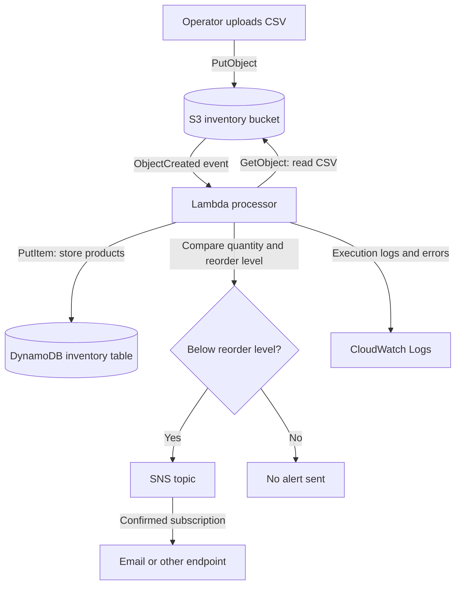

# Serverless Inventory Processing System

An event-driven example that imports inventory CSV files into DynamoDB and publishes low-stock alerts with AWS services.

## End-to-end flow



### Flow explained

1. An operator uploads a CSV object to S3. The bucket notification invokes Lambda for object-created events.
2. Lambda reads the bucket and object key from the S3 event, downloads the CSV, and parses the rows.
3. For each row, Lambda writes an item to DynamoDB using `product_id` as the partition key. A repeated ID replaces the previous item because the code uses `put_item`.
4. Lambda checks whether `quantity < reorder_level`. If any items are below the threshold and `SNS_TOPIC_ARN` is set, it publishes a combined alert to SNS.
5. SNS notifies subscribers; email subscriptions must be confirmed. Lambda logs activity to CloudWatch Logs.

## CSV format

Required columns: `product_id`, `product_name`, and `quantity`. Optional: `reorder_level` (defaults to 10) and `price` (defaults to 0.00).

```csv
product_id,product_name,quantity,reorder_level,price
P-1001,Widget,8,10,4.99
P-1002,Gadget,25,10,12.50
```

P-1001 is stored and triggers a low-stock alert; P-1002 is stored without an alert.

## AWS components

| Service | Role |
| --- | --- |
| S3 | Receives CSV files and emits object-created events. |
| Lambda | Parses CSV rows, writes inventory, and checks stock levels. |
| DynamoDB | Stores one item per product, keyed by `product_id`. |
| SNS | Publishes low-stock messages to subscribed endpoints. |
| CloudWatch Logs | Stores Lambda execution logs for troubleshooting. |

## Repository structure

```text
serverless-inventory/
├── README.md
├── template.yaml
├── docs/implementation-guide.md
├── lambda/process_inventory.py
└── screenshots/placeholder.txt
```

## Deployment and testing

The CloudFormation template describes the bucket, table, function, execution role, SNS topic, and S3 invoke permission. The implementation guide contains initial deployment notes.

This is an example, not a verified deployment package. Before deploying, package the Lambda function with a supported workflow and validate the template: its current `Code: ./lambda` value is not a standard `AWS::Lambda::Function.Code` structure. Also review S3 notification deployment ordering, IAM least privilege, region-specific settings, and SNS subscriptions. Test in a non-production AWS account with one low-stock and one in-stock row; verify DynamoDB items, logs, and notifications.

## Known limitations

- The implementation guide currently ends mid-command.
- The Lambda response counts rows by iterating the CSV reader after it has already been consumed, so its reported processed-item count can be zero.
- Review the template and permissions before deployment; this repository has not been validated as a production-ready package.

## Source and attribution

This project content is reproduced with permission from [VanshPatyal/serverless-inventory-system](https://github.com/VanshPatyal/serverless-inventory-system). This repository has a fresh commit history and credits the original project; the source commit history was not imported.
