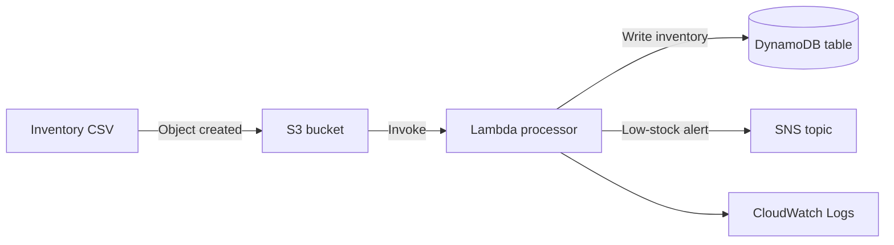

# Serverless Inventory

An AWS serverless inventory processing example using S3, Lambda, DynamoDB, and SNS.

## Architecture



## Repository structure

```text
serverless-inventory/
├── README.md
├── template.yaml
├── docs/
│   └── implementation-guide.md
├── lambda/
│   └── process_inventory.py
└── screenshots/
    └── placeholder.txt
```

## Source and attribution

This selected project content is reproduced with permission from [VanshPatyal/serverless-inventory-system](https://github.com/VanshPatyal/serverless-inventory-system). This repository has a fresh commit history and credits the original project; the source commit history was not imported.

## Review before deployment

The included files are examples copied from the source project, not a verified deployment package. The implementation guide currently ends mid-command, and the CloudFormation template's Lambda `Code` value should be reviewed because `./lambda` is not a standard `AWS::Lambda::Function.Code` structure. Validate the template and permissions in a safe AWS account before deployment.
