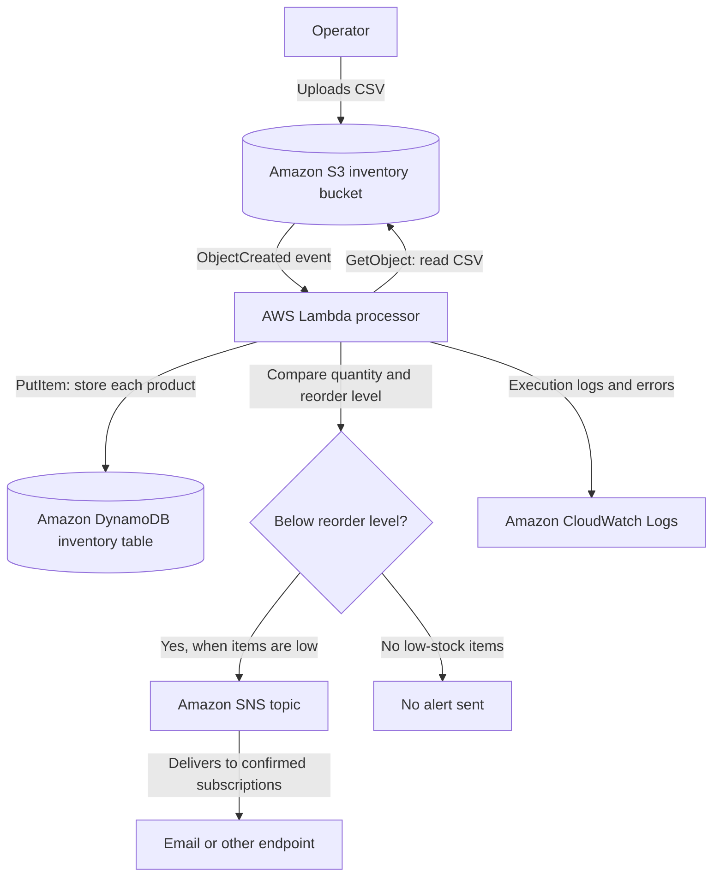
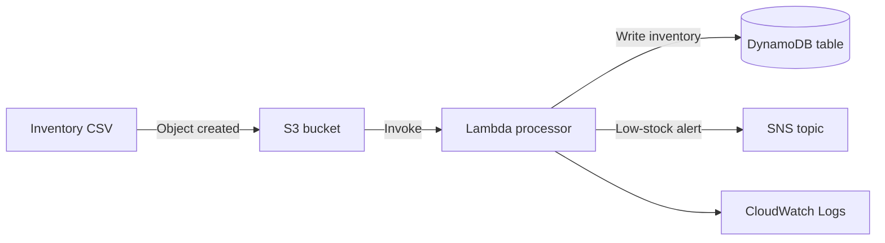

# Serverless Inventory Processing System

An event-driven example for importing inventory CSV files into DynamoDB and publishing low-stock alerts with AWS services.

## End-to-end flow



### Flow, step by step

1. An operator uploads a CSV object to the S3 bucket. The bucket notification is configured to invoke the inventory Lambda on object creation.
2. Lambda reads the bucket and object key from the S3 event, downloads the file, and parses it with Python's CSV reader.
3. For each row, Lambda constructs an inventory item and writes it to DynamoDB using `product_id` as the table's partition key. A repeated product ID replaces the previous item because the code uses `put_item`.
4. Lambda checks whether `quantity < reorder_level`. If one or more items meet that condition and `SNS_TOPIC_ARN` is set, it publishes a combined low-stock message to the SNS topic.
5. SNS sends notifications only to subscribed endpoints. Email subscribers must confirm their subscription. Lambda logs the event and processing messages to CloudWatch Logs.

## CSV input format

Required columns are `product_id`, `product_name`, and `quantity`. The code defaults `reorder_level` to `10` and `price` to `0.00` when those optional columns are absent.

```csv
product_id,product_name,quantity,reorder_level,price
P-1001,Widget,8,10,4.99
P-1002,Gadget,25,10,12.50
```

In this example, P-1001 is below its reorder level and is included in the SNS alert; P-1002 is stored but does not trigger an alert.

## AWS components

| Component | Purpose in this example |
| --- | --- |
| Amazon S3 | Receives CSV uploads and emits object-created events. |
| AWS Lambda | Reads and parses the CSV, writes inventory items, and checks stock levels. |
| Amazon DynamoDB | Stores one item per product, keyed by `product_id`. |
| Amazon SNS | Publishes a message when one or more products are below their reorder levels. |
| Amazon CloudWatch Logs | Receives Lambda runtime logs for troubleshooting. |

## Repository structure

```text
serverless-inventory/
├── README.md
├── template.yaml
├── docs/
│   └── implementation-guide.md
├── lambda/
│   └── process_inventory.py
└── screenshots/
    └── placeholder.txt
```

## Deployment and testing

The template describes the bucket, table, function, execution role, SNS topic, and permission for S3 to invoke Lambda. The implementation guide in `docs/` contains initial deployment notes.

Before deploying, package the Lambda code using a supported workflow (for example AWS SAM or CloudFormation packaging) and validate the template. The current template's `Code: ./lambda` value is not a standard `AWS::Lambda::Function.Code` structure, and direct S3 notification configuration may need deployment-order handling. Check IAM permissions and configure/confirm SNS subscribers in a non-production AWS account.

A basic test should upload a small CSV with one product below its reorder level and one above it, then verify the DynamoDB items, Lambda logs, and SNS notification. Also test malformed rows and missing required columns before using real inventory data.

## Known limitations in the current example

- The implementation guide currently ends mid-command and is incomplete.
- The Lambda response counts rows by iterating the CSV reader after it has already been consumed; the reported processed-item count can therefore be zero.
- The sample template uses a Lambda code location that needs packaging or a supported inline/S3 code configuration before deployment.
- The policy and resource configuration should be reviewed for least privilege, operational safety, and the target AWS region before use.

## Source and attribution

This selected project content is reproduced with permission from [VanshPatyal/serverless-inventory-system](https://github.com/VanshPatyal/serverless-inventory-system). This repository has a fresh commit history and credits the original project; the source commit history was not imported.
# Serverless Inventory

An AWS serverless inventory processing example using S3, Lambda, DynamoDB, and SNS.

## Architecture



## Repository structure

```text
serverless-inventory/
├── README.md
├── template.yaml
├── docs/
│   └── implementation-guide.md
├── lambda/
│   └── process_inventory.py
└── screenshots/
    └── placeholder.txt
```

## Source and attribution

This selected project content is reproduced with permission from [VanshPatyal/serverless-inventory-system](https://github.com/VanshPatyal/serverless-inventory-system). This repository has a fresh commit history and credits the original project; the source commit history was not imported.

## Review before deployment

The included files are examples copied from the source project, not a verified deployment package. The implementation guide currently ends mid-command, and the CloudFormation template's Lambda `Code` value should be reviewed because `./lambda` is not a standard `AWS::Lambda::Function.Code` structure. Validate the template and permissions in a safe AWS account before deployment.
